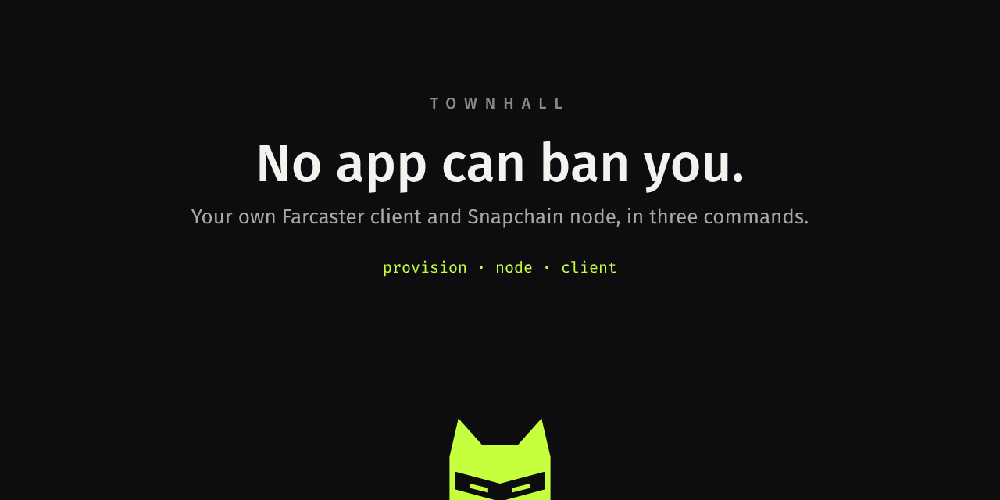

<p align="center"></p>

# townhall

Your own Farcaster client and Snapchain read node, in three commands. No API keys from anyone.

- **Tutorial:** https://townhallfc.xyz ([中文](https://townhallfc.xyz/zh/))
- **Live demo:** https://app.townhallfc.xyz (the author's node and client, built from this repo)
- **License:** MIT

## Quickstart

```bash
# 0. On your computer: create a Hetzner Cloud server and volume
curl -fsSL https://raw.githubusercontent.com/townhall-fc/townhall/main/install/provision.sh | HCLOUD_TOKEN=your_token bash

# 1. On the server: run a Snapchain read node (official compose file)
ssh root@YOUR_IP 'curl -fsSL https://raw.githubusercontent.com/townhall-fc/townhall/main/install/node.sh | bash'

# 2. On the server: build the client from source and serve it over HTTPS
ssh root@YOUR_IP 'curl -fsSL https://raw.githubusercontent.com/townhall-fc/townhall/main/install/client.sh | bash'
```

Already have a server (Ubuntu 22.04 or 24.04, 4 vCPU, 16 GB RAM, 1 TB disk or more)? Skip step 0.

Done testing? Delete the server and volume so billing stops:

```bash
curl -fsSL https://raw.githubusercontent.com/townhall-fc/townhall/main/install/destroy.sh | HCLOUD_TOKEN=your_token bash
```

## What to expect

Measured on the demo node (Hetzner `cx43`, 1 TB volume, Snapchain 0.14.3, October 2026):

| | |
|---|---|
| Hands-on time | about 10 minutes |
| Snapshot download and unpack | about 11 hours (about 445 GB compressed) |
| Catching up to the chain | about 10 hours |
| Disk | peak about 800 GB, about 560 GB once synced |
| App key | one gasless `KEY_ADD`, active in about 10 seconds |

## What the client does

- Reads everything from your node: the feed of people you follow, profiles, threads, replies and mentions.
- Posts with its own app key: casts, replies, quotes, likes, recasts, follows, deletes.
- Share: every cast has a link on your own client that opens for anyone, signed in or not (the share sheet on phones).
- Adds that key from your recovery phrase as a gasless `KEY_ADD` (custody-signed EIP-712, no transaction, no ETH). The phrase is used only in the browser and cleared right after. The key can revoke itself from Settings.
- Shows which app signed each cast and lets you include or exclude casts by app.
- **Voters only:** filters the feed to people who hold the Farcaster VOTE NFT on Base.
- **Live:** the whole network as your node receives it, from the node's event log: casts, likes, follows, profile changes, messages pruned by storage limits, with block heights per shard.
- **Inspect:** every cast can show its protocol message (hash, signer, signing app, signature).
- Search by username or FID; follower and following counts read from your node.
- **Replies from mutuals:** replies and mentions from people you follow who follow you back, with a switch for everyone.
- Writes go to your read node, which validates them and relays them to the validators.

## Let other people use it (optional)

```bash
ssh root@YOUR_IP 'curl -fsSL https://raw.githubusercontent.com/townhall-fc/townhall/main/install/signin.sh | bash'
```

Visitors see a feed with no login and sign in by approving townhall in the Farcaster app (a signed key request), with no recovery phrase. The key is made in the visitor's browser and stays there. The server holds only the key of a separate app account that signs the requests.

## Repository

```
install/   provision.sh (0), node.sh (1), client.sh (2), destroy.sh, signin.sh, snapshot-guard.sh
client/    the web client (TypeScript, Vite, @farcaster/core, viem)
server/    optional sign-in service for hosted use
site/      the tutorial
test/      mock Snapchain node, local chainId 10 chain, end-to-end browser tests
```

Development and tests: see [CONTRIBUTING.md](CONTRIBUTING.md). Security notes and reporting: see [SECURITY.md](SECURITY.md).

## License

MIT, see [LICENSE](LICENSE). Snapchain itself runs from its official image under its own license.
